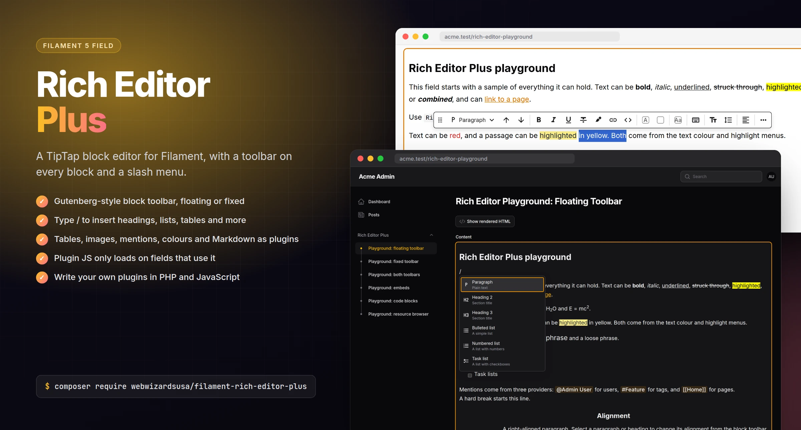
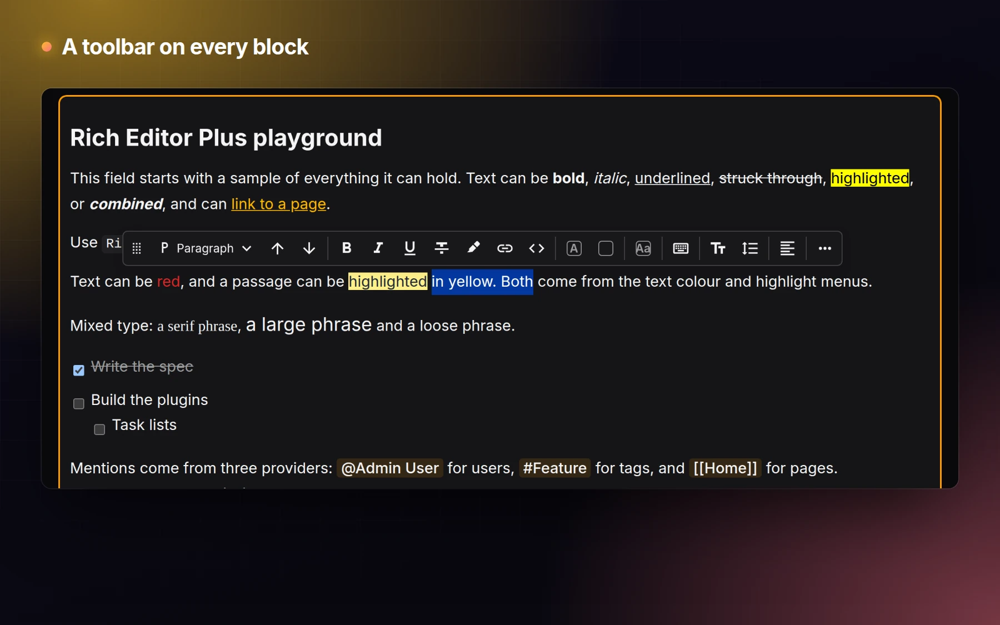
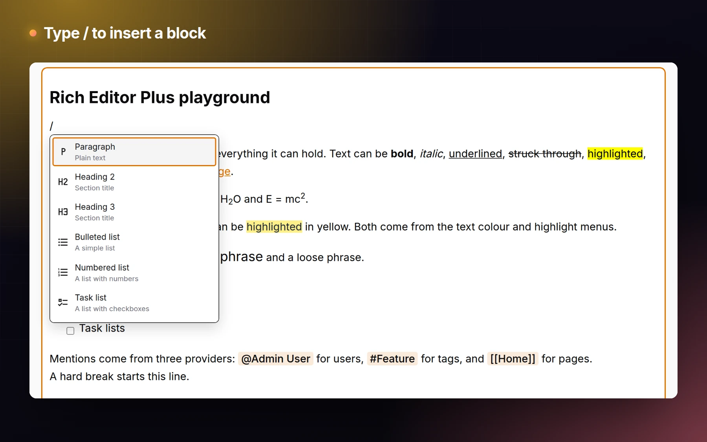
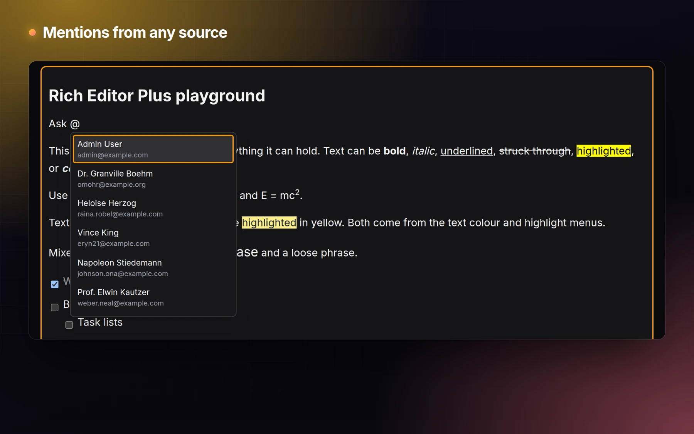
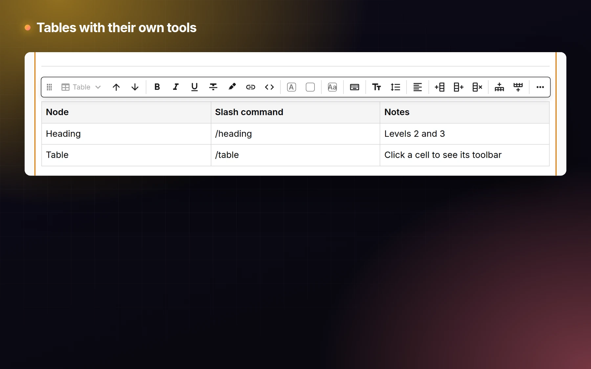

# Rich Editor Plus

> **Under active development.** This package is still changing and may not be ready for production use yet. Until
> 1.0, a minor release can include breaking changes, so check the changelog before you upgrade.



[](https://packagist.org/packages/webwizardsusa/filament-rich-editor-plus)
[](https://github.com/webwizardsusa/filament-rich-editor-plus/actions/workflows/tests.yml)
[](https://packagist.org/packages/webwizardsusa/filament-rich-editor-plus/stats)
[](https://packagist.org/packages/webwizardsusa/filament-rich-editor-plus)
[](https://filamentphp.com)
[](https://github.com/webwizardsusa/filament-rich-editor-plus/blob/main/LICENSE.md)

A rich editor field for Filament, built on TipTap. Each block gets its own toolbar, Gutenberg style, and typing `/`
opens a menu of blocks to insert. Everything the editor can do comes from a plugin, so you can turn features off one
by one, add the optional plugins for tables, images, attachments, mentions, colours and Markdown storage, or write
your own in PHP and JavaScript.

<p align="center">
  
  
</p>

<p align="center">
  
  
</p>

**Requirements:** PHP 8.3 or later and Filament 5.

## Installation

```bash
composer require webwizardsusa/filament-rich-editor-plus
php artisan filament:assets
```

## Usage

```php
use Webwizardsusa\RichEditorPlus\Plugins\Table\TablePlugin;
use Webwizardsusa\RichEditorPlus\RichEditorPlus;

RichEditorPlus::make('body')
    ->addPlugins([TablePlugin::make()])
    ->required();
```

Render the stored content with the same plugins:

```blade
{!! \Webwizardsusa\RichEditorPlus\Rendering\RichContentPlusRenderer::make($post->body)->plugins($plugins)->toHtml() !!}
```

## Documentation

Read the full documentation in the [`docs` folder](https://github.com/webwizardsusa/filament-rich-editor-plus/tree/main/docs).

## About Us

This package is developed and maintained by [WebWizardsUSA](https://webwizardsusa.com/), a top rated web development agency on Upwork.

## License

The MIT License (MIT). See [LICENSE.md](LICENSE.md).
