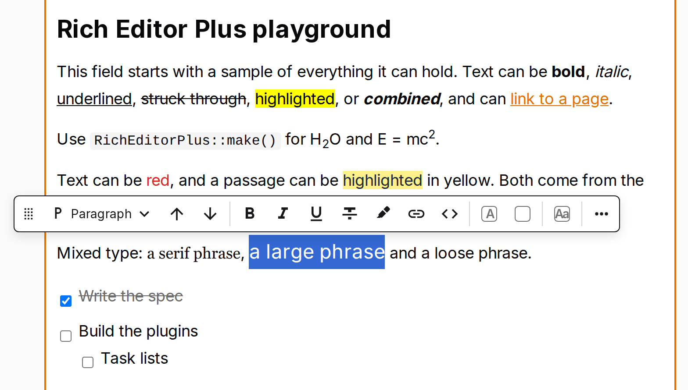
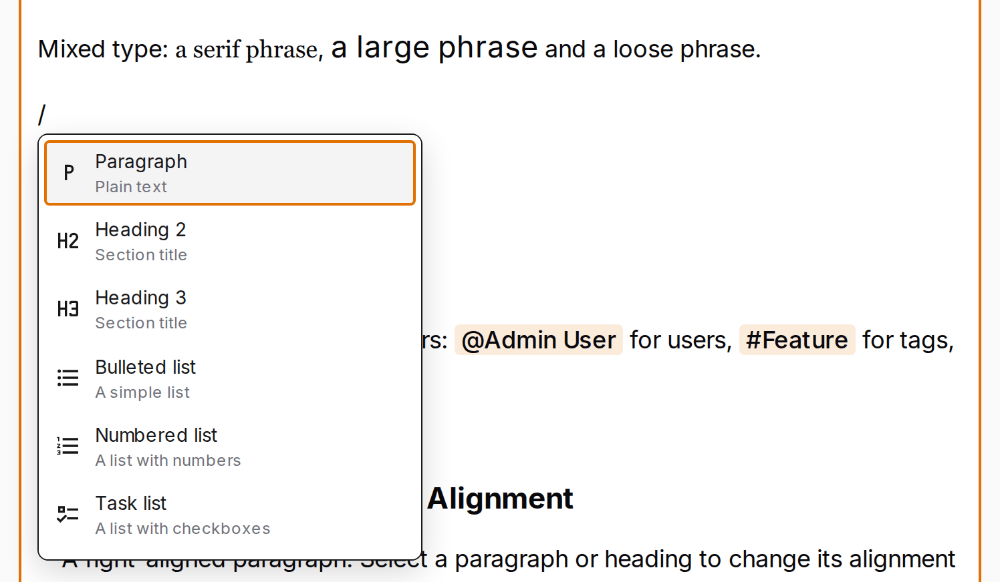

Rich Editor Plus is a rich text field for Filament 5, built on [TipTap](https://tiptap.dev). Each block gets its own
toolbar, Gutenberg style, and typing `/` on an empty line opens a menu of blocks to insert.



Everything the editor can do comes from a plugin: bold text, headings, lists, links and find and replace are all
plugins in the default set. You can turn features off one at a time, configure them per field, add the optional
plugins that ship with the package (tables, images, file attachments, mentions, Markdown storage, colours and fonts),
or write plugins of your own.

```php
use Webwizardsusa\RichEditorPlus\Plugins\Table\TablePlugin;
use Webwizardsusa\RichEditorPlus\RichEditorPlus;

RichEditorPlus::make('body')
    ->addPlugins([TablePlugin::make()])
    ->withoutPlugins(['core/underline'])
    ->required();
```

Type `/` on an empty line to pick a block from the slash menu:



## What a plugin owns

A plugin describes one feature end to end, on both sides of the wire:

- **The schema on the server**: the nodes and marks it adds, how they are parsed from HTML and how they are rendered.
  The server only ever outputs what a plugin declares, so stored content can't smuggle in markup.
- **The TipTap extension in the browser**: either one the editor already ships, or an ES module the plugin's package
  provides, loaded only on fields that use the plugin.
- **Its place in the UI**: toolbar tools, block types for the slash menu and block switcher, and Filament actions
  (modals) such as the link dialog.
- **Optional hooks**: answering requests from the browser, accepting uploads, filling in data at render time,
  rewriting rendered HTML, or giving its content a Markdown form.

Because the same plugins drive the editor and the server, you render stored content with
[`RichContentPlusRenderer`](displaying-content/rendering.md) using the plugins the field uses, and get the same HTML
the editor shows.

## Features

- A floating toolbar on the active block, a fixed toolbar above the editor, or both. See
  [toolbars](using-the-field/toolbars.md).
- Storage as HTML (the default), as the TipTap JSON document, or as Markdown. See
  [storing content](using-the-field/storing-content.md).
- Optional plugins for [tables](plugins/tables.md), [images](plugins/images.md),
  [attachments](plugins/attachments.md), [mentions](plugins/mentions.md), [Markdown](plugins/markdown.md),
  [colours and fonts](plugins/colours-and-fonts.md), [text alignment](plugins/text-align.md) and an
  [HTML source view](plugins/html-source.md).
- Server-side rendering with batched lookups, safe handling of stored HTML, and plain text and Markdown export. See
  [displaying content](displaying-content/rendering.md).
- Works on phones: the floating toolbar sits below the selection, stays above the on-screen keyboard, and tools that
  don't fit move into the More menu.
- Follows Filament's dark mode, and every colour is a CSS variable. See [theming](theming.md).
- An extension API for your own plugins, in PHP and JavaScript. See [writing plugins](writing-plugins/_index.md).

## Requirements

- PHP 8.3 or later, with the `dom` extension
- Filament 5

Continue with [installation](installation.md).
