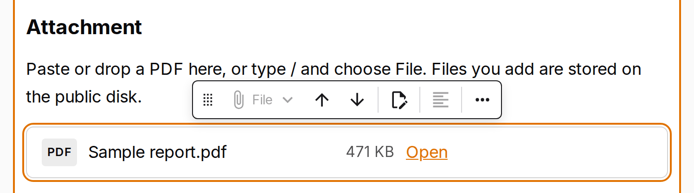

## Attachments

`AttachmentPlugin` adds file attachments: block cards with the file's name, its size and a download link.



```php
use Webwizardsusa\RichEditorPlus\Plugins\Image\AttachmentPlugin;
use Webwizardsusa\RichEditorPlus\Plugins\Image\ImagePlugin;
use Webwizardsusa\RichEditorPlus\RichEditorPlus;

RichEditorPlus::make('content')->addPlugins([
    ImagePlugin::make(),
    AttachmentPlugin::make(),
]);
```

Insert a file from the slash menu's "File" block, or by pasting or dropping it. Select a card to rename or replace the
file from its block toolbar (`editAttachment`).

Every option is shown with its default:

```php
AttachmentPlugin::make()
    ->disk(null)                        // Filament's default disk; `public` in place of `local`
    ->directory('editor-attachments')
    ->visibility('public')              // anything else renders temporary URLs
    ->maxSize(10240)                    // kilobytes
    ->acceptedFileTypes([...])          // PDF, Word, Excel, PowerPoint, OpenDocument, plain text, CSV and ZIP
    ->temporaryUrlMinutes(30)
    ->urlUsing(fn (string $disk, string $path): string => ...); // not set by default
```

The storage options work as for [images](images.md#where-images-are-stored): the content stores the disk and path, the
link is resolved when the content is shown, only safe paths inside the directory are used, and a private disk needs a
directory per tenant. The default types are listed in `AttachmentPlugin::DEFAULT_TYPES`.

The field's `fileAttachmentsDisk()`, `fileAttachmentsDirectory()`, `fileAttachmentsVisibility()` and
`fileAttachmentsMaxSize()` are used for whatever the plugin wasn't given. The field's accepted types are not, since
Filament's editor attachments are images.

> [!IMPORTANT]
> HTML, XHTML, SVG, XML, JavaScript, PHP, shell scripts and executables are never accepted, even when configured: a
> file on a public disk is served from your own domain, so one of these could run script there. The list is
> `AttachmentPlugin::DENIED_TYPES`.

The stored card:

```html
<div class="rep-attachment" data-type="attachment" data-disk="public" data-path="editor-attachments/3b1d….pdf" data-size="48213" data-mime="application/pdf"><a download="Report.pdf">Report.pdf</a><span class="rep-attachment-size">47 KB</span></div>
```

When rendered for display, the link gets its `href`. Include `AttachmentPlugin::make()->getStylesheet()` on pages that
show content, as for images. Deleting an attachment from the content does not delete its file.

Attachments store a disk and a path, which Markdown can't hold, so the plugin can't be used on a
[Markdown](markdown.md) field.

## Pasting and dropping files

With `ImagePlugin` on a field, images pasted into the editor or dropped onto it are uploaded and inserted. With
`AttachmentPlugin` too, other accepted files become file cards. Each file shows an "Uploading…" placeholder with its
progress, and the form waits to save until every file of the paste or drop is stored and in the content.

- One pasted or dropped image opens the image modal for its alt text and caption. Several are inserted directly and
  show a "Needs alt text" badge in the editor until they have alt text (with `->altRequired(false)` there is no badge).
- A paste that contains HTML (from a web page or a word processor) is pasted as content, not uploaded.
- At most 10 files are added per paste or drop.
- The editor routes each file by the type the browser reports, knowing its other names (a ZIP reported as
  `application/x-zip-compressed`, a CSV as `text/x-csv`, a JPEG as `image/pjpeg`). A file the browser reports no type
  for goes to `AttachmentPlugin`, when the field has it.
- Each plugin then checks the file's real type from its contents and its size before storing it on its own disk and
  directory. The browser only ever sends a temporary upload.
- A file that is rejected or fails to upload loses its placeholder and shows a Filament notification. If the content
  around a placeholder is deleted while it uploads, the file is still saved to the disk but not added to the content,
  and a notification says so.
- Uploads finish without moving the caret, so you can keep typing while they run.

> [!TIP]
> Livewire's temporary uploads have their own size limit (12 MB by default). For a larger `maxSize()`, raise
> `livewire.temporary_file_upload.rules` in `config/livewire.php`, for example to `['required', 'file', 'max:51200']`.

## Turning uploads off

- `ImagePlugin::make()->allowUploads(false)` keeps linked images but takes no image files.
- `fileAttachments(false)` on the field turns image uploads off, and the field takes no uploads at all.
- A field with no plugin that takes uploads refuses them on the server too.
