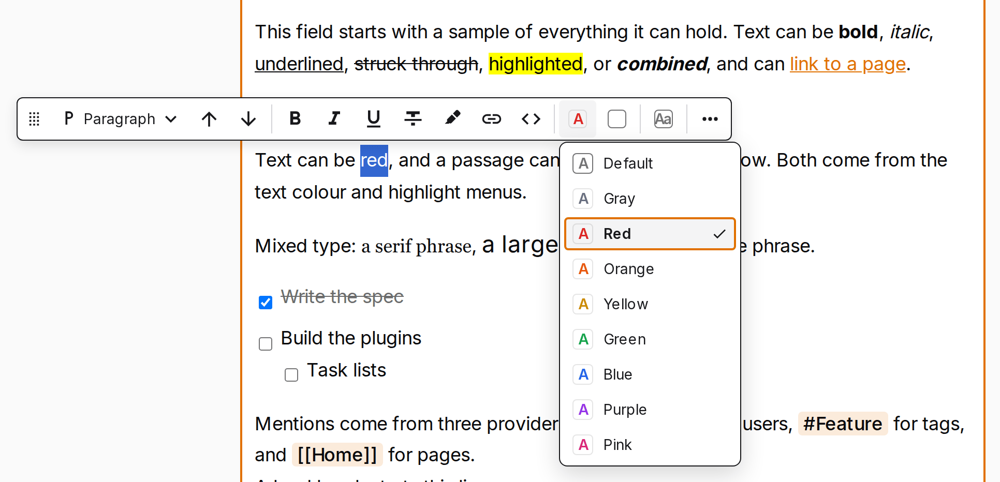
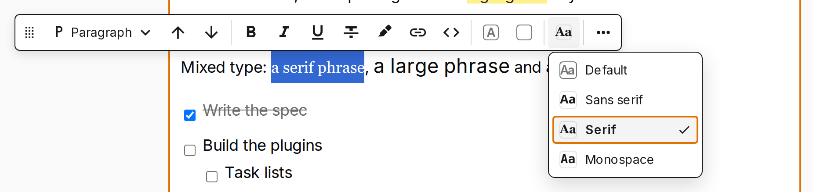

Five optional plugins style selected text from a **palette** of named values:

| Plugin | Tool | Palette method | Value key | Class |
|---|---|---|---|---|
| `TextColorPlugin` | `textColor` | `colors()` | `color` | `has-{name}-color` |
| `BackgroundColorPlugin` | `backgroundColor` | `colors()` | `color` | `has-{name}-background-color` |
| `FontFamilyPlugin` | `fontFamily` | `fonts()` | `family` | `has-{name}-font-family` |
| `FontSizePlugin` | `fontSize` | `sizes()` | `size` | `has-{name}-font-size` |
| `LineHeightPlugin` | `lineHeight` | `heights()` | `height` | `has-{name}-line-height` |

Each adds a menu to the inline toolbar, after the formatting buttons, starting with a "Default" item that clears the
value. They all store their choice on the same `<span>` (TipTap's `textStyle` mark), so they combine with each other:

```html
<p>Some <span class="has-red-color has-large-font-size">large red</span> text.</p>
```

Storing a class rather than an inline style keeps stored content free of CSS: a value can only be one of your palette
entries, and you can change what `red` looks like later without touching the content.

## Colours



```php
use Webwizardsusa\RichEditorPlus\Plugins\Core\BackgroundColorPlugin;
use Webwizardsusa\RichEditorPlus\Plugins\Core\TextColorPlugin;
use Webwizardsusa\RichEditorPlus\RichEditorPlus;

RichEditorPlus::make('body')->addPlugins([
    TextColorPlugin::make()->colors([
        'brand' => ['label' => 'Brand', 'color' => '#7c3aed'],
        'muted' => ['label' => 'Muted', 'color' => '#6b7280'],
    ]),
    BackgroundColorPlugin::make(), // the default palette
]);
```

- Each plugin has a default palette of eight colours: `gray`, `red`, `orange`, `yellow`, `green`, `blue`, `purple` and
  `pink`. `colors()` replaces it.
- A `BackgroundColorPlugin` entry takes an optional `text` colour for the text inside the highlight. The default
  palette uses dark text (`#1f2937`), so highlights stay readable in dark mode. It is written as a zero-specificity
  `:where()` rule, so a text colour on the same span always wins. `TextColorPlugin` ignores `text`.

```php
BackgroundColorPlugin::make()->colors([
    'note' => ['label' => 'Note', 'color' => '#fef08a', 'text' => '#422006'],
]);
```

## Fonts, sizes and line heights



```php
use Webwizardsusa\RichEditorPlus\Plugins\Core\FontFamilyPlugin;
use Webwizardsusa\RichEditorPlus\Plugins\Core\FontSizePlugin;
use Webwizardsusa\RichEditorPlus\Plugins\Core\LineHeightPlugin;
use Webwizardsusa\RichEditorPlus\RichEditorPlus;

RichEditorPlus::make('body')->addPlugins([
    FontFamilyPlugin::make()->fonts([
        'brand' => ['label' => 'Brand', 'family' => '"Inter", sans-serif'],
        'serif' => ['label' => 'Serif', 'family' => 'ui-serif, Georgia, serif'],
    ]),
    FontSizePlugin::make()->sizes([
        'small' => ['label' => 'Small', 'size' => '0.875em'],
        'large' => ['label' => 'Large', 'size' => 'clamp(1.125rem, 2vw, 1.5rem)'],
    ]),
    LineHeightPlugin::make(), // the default palette
]);
```

The default palettes:

| Plugin | Entries |
|---|---|
| `FontFamilyPlugin` | `sans`, `serif`, `mono` (system font stacks) |
| `FontSizePlugin` | `small` (`0.875em`), `large` (`1.25em`), `x-large` (`1.5em`), `xx-large` (`2em`) |
| `LineHeightPlugin` | `tight` (`1.25`), `relaxed` (`1.75`), `loose` (`2`) |

- The font menu shows each font's name in its own typeface. The size and line height menus are plain lists.
- The plugins name fonts only. Web fonts must be loaded by your site, for example in its own stylesheet.
- Line height applies to the selected text, so it can make lines taller but not tighter. To tighten whole paragraphs,
  set it in your site's CSS.

## Palette rules

Every value is printed into a `<style>` element, so palettes are checked when the plugin is used, and a bad entry
throws an `InvalidArgumentException`:

- Names are lower-case letters, digits and hyphens, and don't start with a hyphen. `default` is reserved for the
  "Default" item. Every entry needs a non-empty `label`.
- No value may contain `;`, `{`, `}`, `<`, `>`, `\`, `/*`, `*/` or a control character such as a line break or tab.
- A **colour** may not contain quotes, and its parentheses must balance.
- A **font** is a comma-separated list of names, such as `ui-serif, Georgia, serif`. Quote a name that needs it, as in
  `"Open Sans"`. Names with characters other than ASCII letters, digits, hyphens and spaces must be quoted. A bare name
  may start with a hyphen, as in `-apple-system`. Quoted names may not contain quotes, backslashes or line breaks.
- A **size** is a length (`1.25rem`, `120%`), `0`, a size keyword (`large`), `var(--name)`, or one `clamp()`, `min()`,
  `max()` or `calc()` holding numbers with units, the operators `+ - * /`, commas, spaces, `var(--name)` and nested
  math functions, with balanced parentheses. Units are `px`, `rem`, `em`, `%`, `pt`, `vw`, `vh`, `ch`, `ex`, `lh`,
  `vmin`, `vmax`, `svw`, `svh`, `dvw`, `dvh`, `lvw`, `lvh`, `cqi` and `cqb`.
- A **line height** is a number (`1.5`), a number with one of the units above, `normal`, or `var(--name)`.
- Two entries can't get the same class.

## Class names

Change the classes with `classUsing()`, for example to match a design system:

```php
TextColorPlugin::make()->classUsing(fn (string $name): string => "text-{$name}");
```

The callback must return a valid CSS class name.

## Showing styled content

The field prints the palette CSS itself. A page that displays the content must include it too, from each plugin's
`getStylesheet()`, configured exactly as on the field:

```blade
<style>
    {!! \Webwizardsusa\RichEditorPlus\Plugins\Core\TextColorPlugin::make()->getStylesheet() !!}
    {!! \Webwizardsusa\RichEditorPlus\Plugins\Core\BackgroundColorPlugin::make()->getStylesheet() !!}
</style>
```

See [plugin stylesheets](../displaying-content/on-your-pages.md#plugin-stylesheets) for the details.

Changing a palette later:

- A class means one value site-wide: two fields that give the same name different values clash on a page that shows
  both.
- Removing an entry strips that value from content the next time it is saved. Until then the class stays in stored
  HTML, and renders unstyled once its rule is gone.

## Markdown

Markdown has no syntax for colours or fonts, so these plugins can't be used on a [Markdown](markdown.md) field.

## Writing a palette plugin

A palette for another CSS property can extend `Webwizardsusa\RichEditorPlus\Plugins\Core\PaletteStylePlugin`, which
these five share. The base class gives you the menu, the classes, the stylesheet and the shared value checks; a
subclass implements the hooks that differ (`attributeName()`, `commandName()`, `cssProperty()`, `valueKey()`,
`defaultClass()`, `defaultPalette()`, the tool's name, label key, icon, group and order, and optionally
`assertValue()`).

Two things are not shared, so plan for them:

- **The browser half.** The editor registers JS only for its own five palette plugins. Your package must
  [register a JS extension](../writing-plugins/javascript.md) under the plugin's id that adds the `set{Command}` and
  `unset{Command}` commands, setting and clearing the attribute on the `textStyle` mark. The attribute itself is
  generated from the plugin's global attribute. The browser's `textStyle` mark is loaded by the core palette
  plugins, so on a field without one of them your extension must provide that mark too.
- **Translations.** The base class reads the tool label (`toolLabelKey()`) and the default palette's labels from the
  package's own `rich-editor-plus::tools.*` strings. A plugin in another package passes a palette with explicit
  labels, or overrides `getTools()`.
