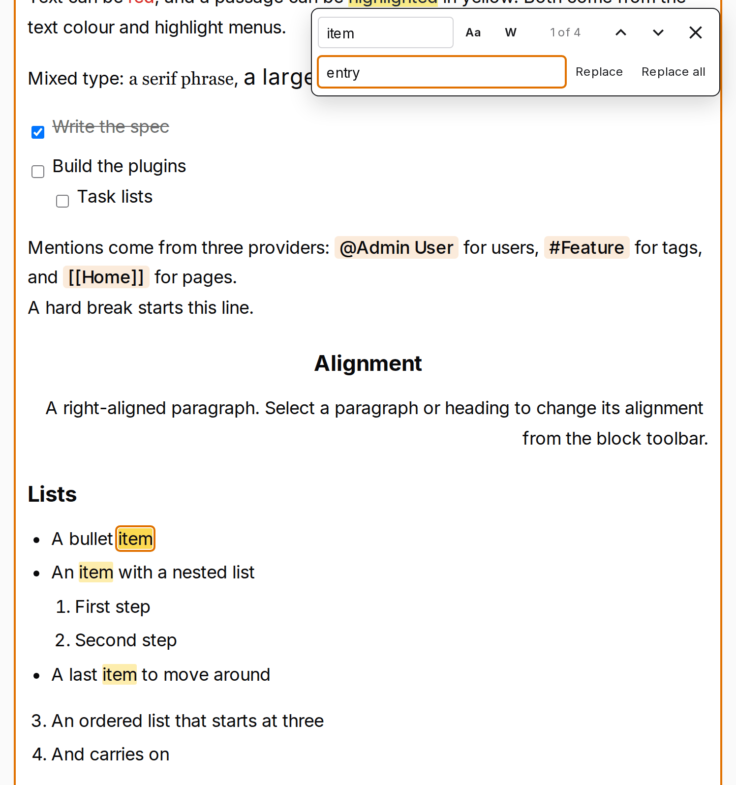

`FindReplacePlugin` is in the default set. Open it from the toolbar's More menu, or from the slash menu ("Find and
replace").



The panel highlights every match and shows how many there are. It has:

- options to match case (`Aa`) and to match whole words only (`W`),
- previous and next buttons to move between matches,
- "Replace", which replaces the current match, and "Replace all".

In the find box, Enter moves to the next match and Shift+Enter to the previous one. In the replace box, Enter
replaces the current match. Escape closes the panel.

Replacing is an ordinary edit, so undo brings back what was replaced.

The plugin adds no content of its own, so it works on every field, including [Markdown](markdown.md) fields. To remove
it:

```php
RichEditorPlus::make('body')->withoutPlugins(['core/find-replace']);
```

The match highlight colours are the `--rep-find-match` and `--rep-find-current` CSS variables. See
[theming](../theming.md).
