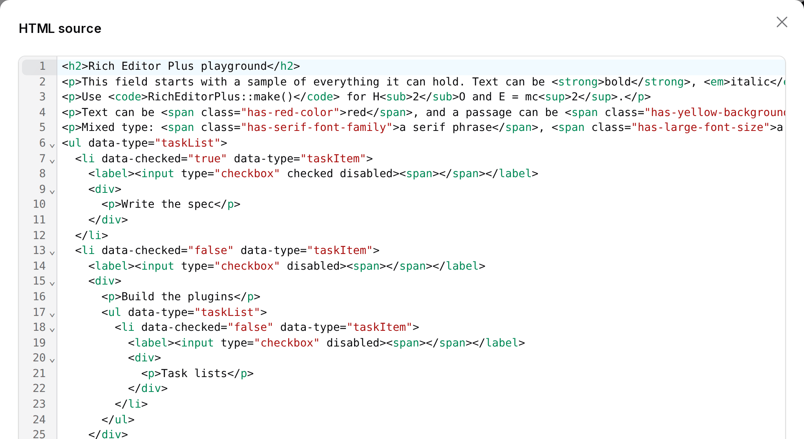

`HtmlSourcePlugin` adds an "HTML source" item to the toolbar's More menu. It opens a Filament modal with the field's
content as HTML, one block per line, in Filament's code editor:

```php
use Webwizardsusa\RichEditorPlus\Plugins\Core\HtmlSourcePlugin;
use Webwizardsusa\RichEditorPlus\RichEditorPlus;

RichEditorPlus::make('body')->addPlugins([HtmlSourcePlugin::make()]);
```



- It shows HTML whatever the field stores: HTML, JSON or Markdown. A Markdown field also has its own
  [Markdown source view](markdown.md#markdown-source-view).
- "Apply" replaces the editor's content with the edited HTML. Undo in the editor brings back what was there before.
- The HTML is read with the field's plugins, as pasted HTML is: anything they don't support, such as a `<script>`, an
  unknown tag or a class no plugin allows, is dropped. Open the modal again to see what was kept.
- Text typed outside any block is wrapped in a paragraph. Clearing the HTML empties the editor.

Because the HTML goes through the same plugins as everything else, the source view can't be used to get markup into
the content that the field wouldn't otherwise keep. It is safe to offer to any editor who can use the field.
