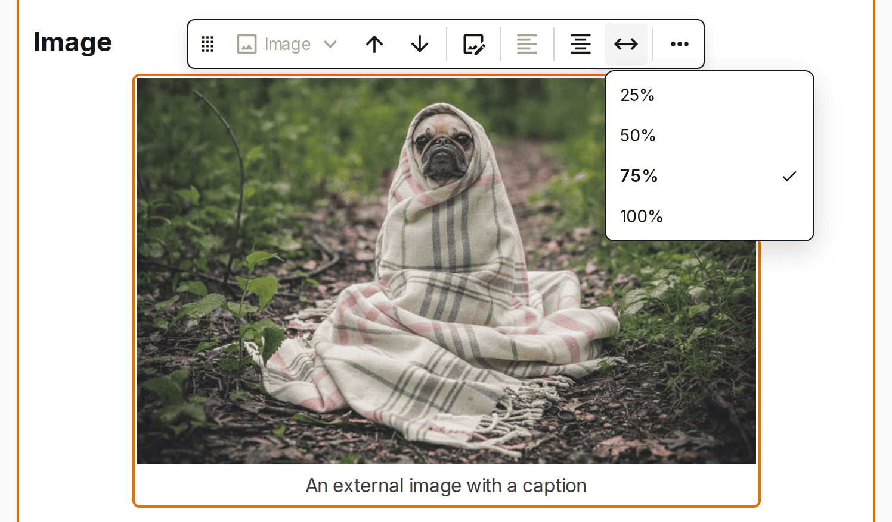

`ImagePlugin` adds images: upload a file to a Laravel disk or link to a web image, then give it alt text, a caption,
an alignment and a width. Images are blocks, inserted from the slash menu ("Image") or by pasting or dropping image
files, and edited from the block toolbar.



```php
use Webwizardsusa\RichEditorPlus\Plugins\Image\ImagePlugin;
use Webwizardsusa\RichEditorPlus\RichEditorPlus;

RichEditorPlus::make('body')->addPlugins([ImagePlugin::make()]);
```

With the default `public` disk, run `php artisan storage:link` once.

## Options

Every option is shown with its default:

```php
ImagePlugin::make()
    ->disk(null)                                  // Filament's default disk; `public` in place of `local`
    ->directory('editor-images')
    ->visibility('public')                        // 'public', or anything else for temporary URLs
    ->maxSize(5120)                               // kilobytes
    ->acceptedFileTypes(['image/jpeg', 'image/png', 'image/gif', 'image/webp'])
    ->allowUrls()                                 // let editors link to an external image
    ->allowUploads()                              // let editors upload, paste and drop image files
    ->altRequired()                               // alt text is required unless the image is marked decorative
    ->widths(['25' => '25%', '50' => '50%', '75' => '75%', '100' => '100%'])
    ->defaultWidth('100')
    ->defaultAlignment('center')                  // 'left', 'center', 'right' or 'wide'
    ->temporaryUrlMinutes(30)
    ->urlUsing(fn (string $disk, string $path): string => ...); // not set by default
```

- The disk defaults to Filament's default disk (`filament.default_filesystem_disk`), using `public` in place of `local`
  while the visibility is `public`, as Filament's own uploads do.
- `widths()` maps a key, which is stored in the content, to a CSS length (`%`, `px`, `rem`, `em`), `auto` or a CSS
  variable. The default width must be one of the keys.
- `acceptedFileTypes()` takes MIME types and `type/*` wildcards such as `image/*`, in the modal and for pasted and
  dropped files alike. A wildcard never matches SVG, HTML, XML or JavaScript: those are taken only when listed by name.
- `allowUploads(false)` leaves only the URL field: the modal has no upload, the editor stops taking pasted and dropped
  image files, and the server refuses image uploads.
- `disk()`, `directory()`, `visibility()`, `maxSize()` and `acceptedFileTypes()` take a closure, which is called
  whenever the setting is needed.
- The field's `fileAttachmentsDisk()`, `fileAttachmentsDirectory()`, `fileAttachmentsVisibility()`,
  `fileAttachmentsMaxSize()` and `fileAttachmentsAcceptedFileTypes()` are used for whatever the plugin wasn't given,
  and `fileAttachments(false)` turns uploads off.
- Width keys are lower-case letters, digits and hyphens. Accepted types must all be `image/` types.
- An invalid configuration, such as a disk that isn't configured, a default width that isn't a key, an unknown
  alignment, or both uploads and URLs turned off, throws an `InvalidArgumentException` when the plugin is used.

## Where images are stored

An uploaded image is saved to the plugin's disk, in its directory, and the content stores the **disk and path**,
never the URL:

```html
<figure class="rep-image" data-type="image" data-disk="public" data-path="editor-images/9f2c….jpg" data-align="center" data-width="100"><figcaption>Napping</figcaption></figure>
```

The file is stored under a random name with the extension of its real type, detected from its contents. The name and
type the browser reports are never used for it, and a file whose contents are not an accepted type is refused.

The URL is resolved when the content is rendered and when the editor shows the image:

- With `visibility('public')` it is the disk's `url()`. Each upload is also made public on the disk when the disk
  allows it. An S3 bucket that refuses ACLs keeps the file as its bucket policy says, so give such a bucket a policy
  that lets readers fetch the directory.
- With any other visibility, such as `'private'`, it is a temporary URL that lasts `temporaryUrlMinutes()`. The disk
  must support temporary URLs, as S3 does.
- `urlUsing(fn (string $disk, string $path) => ...)` replaces both, for a CDN or a signed route. It gets the disk and
  path after they have been checked.

Because stored content comes from the browser, a path is only used when it is safe: the plugin's own disk, and a
relative path inside the plugin's directory with no `.`, `..` or empty segments, no leading `/`, no `\` or `%`
anywhere, and no control characters. Anything else, such as `../../.env` or a path on another disk, renders without a
`src` and is never signed. The same rule applies to the directory you configure.

> [!WARNING]
> On a private disk, anyone who can open the field can get a temporary URL for any file in the plugin's directory,
> not only the images in the record they are editing. Give private images a directory per tenant (or per record), so
> one tenant can't reach another's files:
>
> ```php
> ImagePlugin::make()
>     ->disk('s3')
>     ->visibility('private')
>     ->directory(fn (): string => 'editor-images/'.Filament::getTenant()->getKey());
> ```

The editor asks the server for the URLs of the images it shows, in batches of up to 100 paths, and keeps them while
the editor is open. In a very long editing session a temporary URL can expire before the page is reloaded, and the
image stops showing until it is.

## External images

With `allowUrls()` (the default), the image modal offers a "URL" source for `http` and `https` images and for relative
URLs (`/images/logo.png`, `images/logo.png`, `//cdn.example.com/logo.png`). They are stored as `data-url` and rendered
with that URL as their `src`. Other schemes, such as `javascript:` or `data:`, are never accepted. The image is loaded
straight from its site by every reader's browser.

A relative URL is resolved against the page showing the content, so the editor (inside your panel) and your public
pages may load different files. A root-relative URL (`/images/logo.png`) gives the same file on both when they share a
domain.

With `allowUrls(false)`, only uploads can be added. External images already in stored content keep their URL when
they are edited.

## Alt text and captions

Alt text is required unless you call `altRequired(false)`. Then the modal offers a "Decorative image" checkbox, which
saves an empty `alt` so screen readers skip the image. The caption is optional and renders as a `<figcaption>`.

## Editing images

Select an image to see its block toolbar: edit (`editImage`, which reopens the modal), alignment (`imageAlign`:
left, center, right or wide) and width (`imageWidth`, from `widths()`).

When editing, leaving the upload empty keeps the current image, as long as its stored path is still a safe path on
the plugin's disk; otherwise a new upload is required. Choosing a new file replaces the image.

> [!NOTE]
> Deleting an image from the editor does **not** delete its file. The same file may be used by other content, or by
> an older version of it, so remove files nothing uses with your own cleanup.

## Pasting and dropping

Images pasted into the editor (screenshots, copied image files) or dropped onto it are uploaded and inserted. See
[pasting and dropping files](attachments.md#pasting-and-dropping-files) for how uploads behave.

## SVG images

SVG is not accepted by default, because an SVG file can carry script, and `image/*` never includes it. The type is read
from the file's contents, so an SVG renamed to `.png` is still refused. If you add `image/svg+xml` to
`acceptedFileTypes()` by name, only do so for trusted editors, and serve the files from a disk or domain that does not
share cookies with your application.

## Showing images

Rendered images need the plugin's CSS for alignment and width. The editor loads it by itself; include it on every page
that shows the content, with the same `widths()` as the field, because the stylesheet has one rule per width:

```blade
<style>{!! \Webwizardsusa\RichEditorPlus\Plugins\Image\ImagePlugin::make()->getStylesheet() !!}</style>
```

Render with the same plugin settings as the field, so images get their URLs. See
[rendering](../displaying-content/rendering.md).

## Markdown

On a [Markdown](markdown.md) field, images must be linked rather than uploaded, because Markdown can't hold a disk and
path: use `ImagePlugin::make()->allowUploads(false)` with `allowUrls()` on. Alignment and width tools are removed,
and images use the plugin's defaults.
