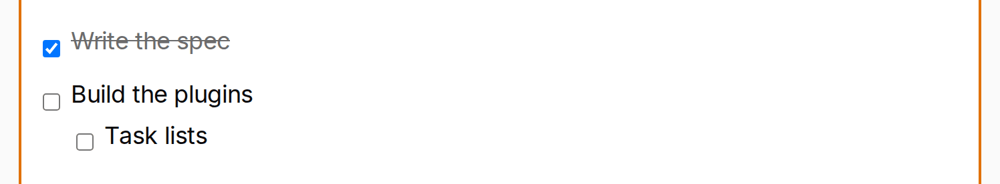

## Bulleted and numbered lists

`BulletListPlugin` and `OrderedListPlugin` are in the default set. They add "Bulleted list" and "Numbered list" block
types, and the usual Markdown-style shortcuts: `- ` or `* ` starts a bulleted list, `1. ` a numbered one.

Inside a list, the toolbar's `listOptions` button opens a menu to switch the list to another list type in place, and
to decrease or increase the level of the current item. Tab and Shift+Tab nest and lift items too. Several selected
paragraphs become one list.

A numbered list keeps its start number (`<ol start="3">`) and its `type` attribute.

## Task lists

`TaskListPlugin` adds a checkbox list, in the list menu next to bulleted and numbered lists:

```php
use Webwizardsusa\RichEditorPlus\Plugins\Core\TaskListPlugin;
use Webwizardsusa\RichEditorPlus\RichEditorPlus;

RichEditorPlus::make('body')->addPlugins([TaskListPlugin::make()]);
```



Typing `[ ] ` or `[x] ` at the start of a line starts a task list. Items can nest, and checkboxes can be ticked in the
editor.

The stored HTML is TipTap's:

```html
<ul data-type="taskList">
    <li data-type="taskItem" data-checked="true">
        <label><input type="checkbox" checked="checked" disabled="disabled"><span></span></label>
        <div><p>Write the docs</p></div>
    </li>
</ul>
```

- Saved and rendered checkboxes are always `disabled`: ticking one on a page that shows the content couldn't save
  anything.
- Style them with `ul[data-type="taskList"]` and `li[data-checked="true"]`.
- In plain text (`toText()`), items start with `[x] ` or `[ ] `.
- TipTap reads only the first `<div>` of a task item as its content, while the server keeps every child, so hand-written
  HTML that splits an item's content over several elements is read differently in the two places.

## Removing list types

Each list type is its own plugin, so remove the ones you don't want:

```php
RichEditorPlus::make('body')->withoutPlugins(['core/ordered-list']);
```

The list menu then offers only the list types that are left.
