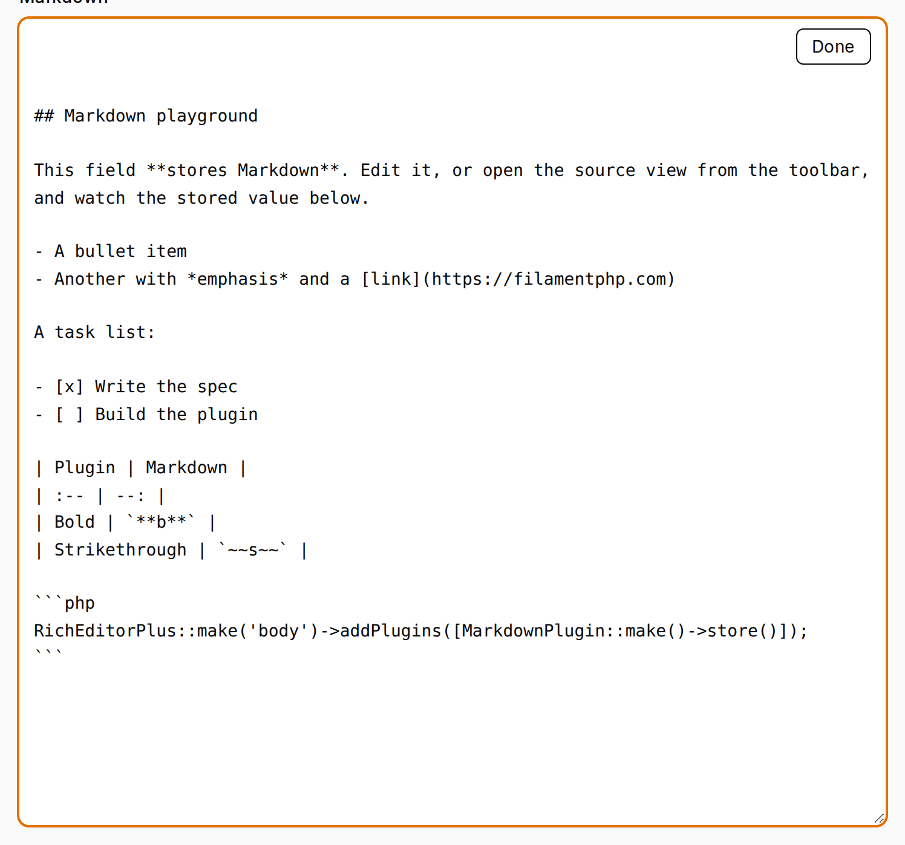

`MarkdownPlugin` and `MarkdownFormat` add Markdown to the editor: store a field's content as Markdown, paste Markdown as
formatted content, switch to a Markdown source view while editing, and export any content to Markdown.

Conversion happens in PHP in both directions (CommonMark with the GitHub-flavoured extensions to read, a rules-based
serializer to write), so stored content, pasted content and the source view always agree. The editor itself keeps
editing a document.

## Storing Markdown

```php
use Webwizardsusa\RichEditorPlus\Plugins\Markdown\MarkdownPlugin;
use Webwizardsusa\RichEditorPlus\RichEditorPlus;

RichEditorPlus::make('body')->addPlugins([MarkdownPlugin::make()->store()]);
```

That stores Markdown, and turns on the source view and Markdown paste. To store Markdown without the plugin's editor
features, set the format directly:

```php
use Webwizardsusa\RichEditorPlus\Plugins\Markdown\MarkdownFormat;

RichEditorPlus::make('body')->storeAs(MarkdownFormat::make());
```

The column holds Markdown, so use a `text` or `longText` column. A value that was stored as HTML or JSON before is read
as Markdown, so convert existing rows first (see [exporting Markdown](#exporting-markdown)).

A Markdown field only allows plugins whose content has a Markdown form:

- **Default plugins** Markdown can't keep (`UnderlinePlugin`) are left out quietly.
- **Plugins you add** that Markdown can't keep make the field throw when it boots, naming all of them at once:

  ```text
  Markdown storage can't keep: UnderlinePlugin (no Markdown syntax for underline), TablePlugin (column widths: call ->resizable(false)).
  ```

- Tables and images need one setting each:

  ```php
  TablePlugin::make()->resizable(false);
  ImagePlugin::make()->allowUrls()->allowUploads(false);
  ```

- The tools Markdown can't express (`mergeOrSplit`, `toggleHeaderRow`, `imageAlign`, `imageWidth`) are removed from
  every toolbar and the slash menu. Images use the plugin's default alignment and width.

## Which plugins work

| Plugin | Allowed | Markdown |
|---|---|---|
| Document (`paragraph`, `text`, `hardBreak`) | Yes | Paragraphs separated by one blank line. Hard break: `\` and a newline. |
| Bold, Italic, Strikethrough, Code | Yes | `**b**`, `*i*`, `~~s~~`, `` `c` ``. A code span's fence is one backtick longer than the longest run inside it. |
| Link | Yes | `[text](url)`, plus `"title"` when present. URLs with spaces or parentheses are written in `<...>`. |
| Heading | Yes | `#` to `######` |
| Quote | Yes | `> ` on every line, nested |
| Bulleted list, Numbered list | Yes | `- ` and `1.`. A numbered list's start number is kept. Multi-paragraph items are written loose. |
| Task list | Yes | `- [ ] ` and `- [x] ` |
| Code block | Yes | Fenced with the language (`` ```php ``). The fence is longer than any backtick run in the code. |
| Divider | Yes | `---` |
| Find and replace, Trailing node, HTML source | Yes | No content of their own |
| Table | With `->resizable(false)` | GFM table, see below |
| Image | With `->allowUploads(false)` and `allowUrls()` | ``, see below |
| Attachment | No | Stores a disk and path, which Markdown can't hold |
| Underline, Subscript, Superscript | No | No Markdown syntax |
| Text align, colours, fonts, sizes, line heights | No | No Markdown syntax |
| Mention | No | No Markdown syntax |

Escaping is minimal: characters are escaped only where they would otherwise start Markdown syntax in their position
(`\*`, `\_`, `` \` ``, `\[`, `\]`, `\<`, a leading `#`, `>`, `-`, `+`, `1.`, or `|` inside table cells). Plain prose
round-trips without added backslashes. Where CommonMark's rules would not honour `**`, `*` or `~~` (for example bold
text that starts with punctuation next to a letter), the serializer writes `<strong>`, `<em>` or `<del>` instead, so
the emphasis survives.

**Tables.** The first row is written as the GFM header row, whatever its cell type; read back, the first row's cells
are headers. Column alignment comes from each header cell (`:--`, `:-:`, `--:`) and applies to the whole column. A cell
is one line: several paragraphs join with `<br>` (read back as hard breaks), and `|` is escaped.

**Images.** The caption is written as the title: ``. A
paragraph holding only an image becomes an image block when read; an image inside text splits the paragraph. Relative
URLs are kept as written. An image whose URL has another scheme (`javascript:`, `data:`) is read as its alt text.

**Code blocks.** A fence with more than a language (```` ```php showLineNumbers ````) keeps its whole info string in
`data-info` on the `<code>`, so a code block plugin can read the rest.

## What Markdown can't keep

Content that arrives outside the editor's tools (pasted, set in code) is normalised when the field saves:

- Merged table cells: the content stays in the first cell, and the covered cells are empty.
- Different alignments within one column: the header cell's wins.
- Blocks other than paragraphs inside table cells: they are reduced to their text. An image in a cell is written as
  its alt text.
- Image alignment and width.
- Empty paragraphs.
- Headings outside the field's levels move to the nearest level (with levels 2 and 3, `#` becomes a level 2 heading
  and `####` a level 3 heading).
- Soft line breaks inside a paragraph become spaces, and spaces at the start of a line are dropped.
- Bare URLs and email addresses become links (GFM autolinks).
- Bold or italic on inline code is dropped, since code excludes other marks.
- Whitespace at the edge of a marked run moves outside it.

## Pasting Markdown

With the plugin on a field, whatever the field stores, pasted plain text that looks like Markdown is converted to
formatted content. The conversion runs on the server against the field's own plugins, so what the field doesn't
support comes back as plain paragraphs.

- It converts when the clipboard has `text/plain` and any line starts with a heading, quote, list marker, task marker,
  numbered item or code fence, or holds a table, `[text](url)`, `**bold**` or `` `code` ``.
- Copied HTML wins: a paste that carries HTML is left to the normal paste, except from code editors (such as VS Code)
  that mark their clipboard.
- Pasting with Shift (Ctrl/Cmd+Shift+V) pastes the text as it is. Nothing converts inside a code block.
- A failed conversion inserts the original text and shows a notice.

Turn it off with `MarkdownPlugin::make()->pasteMarkdown(false)`.

## Markdown source view

A "Markdown source" item in the toolbar's More menu swaps the editor for a Markdown textarea.



It is on by default when the plugin stores Markdown. On other fields, turn it on with `->sourceToggle()`; the field's
plugins must then all have a Markdown form, or the field throws at boot with the same message as above.

```php
RichEditorPlus::make('body')->addPlugins([MarkdownPlugin::make()->sourceToggle()]);
```

- Edits convert back to the document after a short pause, so the form's state stays current, and the form waits for a
  conversion in flight before saving.
- A "Done" bar returns to the editor. While the source view is open the editor is read-only, and the toolbar, the More
  menu and the block controls are locked.
- Undo after returning walks back through the source edits to the document as it was before the switch.

## Exporting Markdown

Any content can be written as Markdown, whatever the field stores:

```php
use Webwizardsusa\RichEditorPlus\Rendering\RichContentPlusRenderer;

$markdown = RichContentPlusRenderer::make($post->body)->plugins($plugins)->toMarkdown();
```

Export is lenient: a node without a Markdown form writes its text, and a mark without one is dropped. Storage is strict
and throws an `UnsupportedContentFormatException`. `MarkdownFormat::make()->lenient()` gives the lenient format for
direct use. To migrate a column of HTML to Markdown, run each row through `toMarkdown()` before switching the field.

To render stored Markdown:

```php
use Webwizardsusa\RichEditorPlus\Plugins\Markdown\MarkdownFormat;

RichContentPlusRenderer::make($post->body)->plugins($plugins)->format(MarkdownFormat::make())->toHtml();
```

Raw HTML in Markdown is kept only as far as the field's plugins parse it.

The editor's conversion requests (pasting and the source view) refuse anything over 1 MB
(`MarkdownFormat::MAX_LENGTH`). Storage and rendering have no limit of their own.

## Your own plugins

A plugin gives its nodes and marks a Markdown form by implementing `ProvidesMarkdownRules`. See
[Markdown rules](../writing-plugins/markdown-and-content-formats.md).
