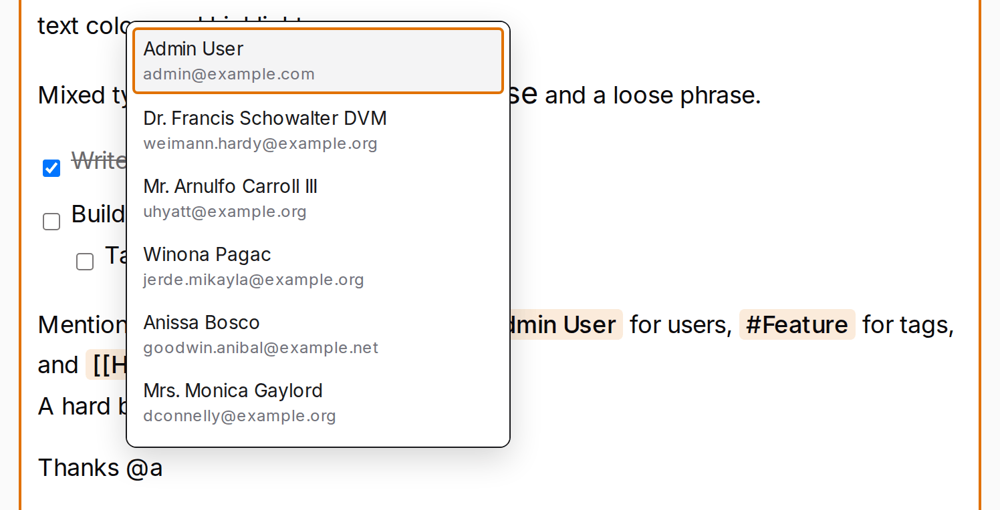

`MentionPlugin` lets editors mention records by typing a trigger, such as `@` for people or `#` for tags. Each trigger
has a `MentionProvider` that finds and labels its records. The plugin is optional, since it does nothing without one.



## Setting up providers

```php
use App\Models\User;
use Webwizardsusa\RichEditorPlus\Plugins\Core\MentionPlugin;
use Webwizardsusa\RichEditorPlus\RichEditorPlus;
use Webwizardsusa\RichEditorPlus\Support\MentionItem;
use Webwizardsusa\RichEditorPlus\Support\MentionProvider;

RichEditorPlus::make('body')->addPlugins([
    MentionPlugin::make()->providers([
        MentionProvider::make('@')
            ->getSearchResultsUsing(fn (string $query, int $limit) => User::query()
                ->where('team_id', auth()->user()->team_id)
                ->where('name', 'like', "%{$query}%")
                ->limit($limit)
                ->get()
                ->map(fn (User $user): MentionItem => MentionItem::make($user->id, $user->name)
                    ->description($user->email)
                    ->avatar($user->avatar_url)))
            ->getLabelsUsing(fn (array $ids): array => User::query()
                ->where('team_id', auth()->user()->team_id)
                ->whereKey($ids)
                ->pluck('name', 'id')
                ->all())
            ->getUrlUsing(fn (string $id): string => route('users.show', $id)),

        MentionProvider::make('#')->items(['news' => 'News', 'releases' => 'Releases']),
    ]),
]);
```

- **`getSearchResultsUsing()`** gets the query and the most results that will be shown. It returns `id => label`, a
  list of `MentionItem`s, or a Collection of either. A `MentionItem` can have a `description()` and an `avatar()` URL.
- **`items()`** is a fixed list of `id => label` (or a closure returning one), searched on the server. Use it instead
  of a search callback for short lists.
- **`getLabelsUsing()`** gets the ids of every mention in the content and returns `id => label`. Labels are looked up
  again whenever content is shown, in the editor and when it is rendered, so a renamed user shows their new name.
  Leave out ids that no longer exist.
- **`getUrlUsing()`** links a rendered mention. It gets the id and the label. Use `getUrlsUsing(fn (array $labels) =>
  [...])` instead when building the links needs a query: it gets `id => label` for every mention at once and returns
  `id => url`. Only `http`, `https` and relative URLs are used.

A mention whose provider looks labels up but no longer returns its id keeps the label stored in the content and is
never linked. That covers deleted records, and ids someone made up by editing the content by hand.

> [!CAUTION]
> **Scope every lookup yourself.** The search and label callbacks run for anyone who can open the page, with any input
> the browser sends, so they must only return records that user may see, for example by filtering to the current
> tenant as above.

## Options

Every option is shown with its default:

```php
MentionProvider::make('@')
    ->allowSpaces(false)        // let a query run on past a space, for full names
    ->minQueryLength(0)         // shorter queries show the search prompt instead of searching
    ->maxQueryLength(100)       // longer queries find nothing and never reach your search
    ->limit(50)                 // the most results shown; the search callback gets it as $limit
    ->displayFormat('@:label')  // how a mention reads; defaults to the trigger followed by the label
    ->searchPrompt('...')       // the messages in the menu; each defaults to a translation
    ->searchingMessage('...')
    ->noResultsMessage('...');
```

Two providers on one plugin can't share a trigger.

## Provider classes

To keep a provider's code in one place, extend `MentionProvider`, set its trigger, and override `search()`, `labels()`
and `url()` (or `urls()`). Pass the class name to `providers()`:

```php
namespace App\Mentions;

use App\Models\User;
use Webwizardsusa\RichEditorPlus\Support\MentionItem;
use Webwizardsusa\RichEditorPlus\Support\MentionProvider;

class UserMentions extends MentionProvider
{
    protected string $trigger = '@';

    public function search(string $query): mixed
    {
        return User::query()
            ->where('name', 'like', "%{$query}%")
            ->limit($this->getLimit())
            ->get()
            ->map(fn (User $user): MentionItem => MentionItem::make($user->id, $user->name));
    }

    public function labels(array $ids): array
    {
        return User::query()->whereKey($ids)->pluck('name', 'id')->all();
    }

    public function url(string $id, string $label): ?string
    {
        return route('users.show', $id);
    }
}
```

```php
MentionPlugin::make()->providers([UserMentions::class]);
```

In a provider class, `$this->getField()` gives you the field, or `null` when content is being rendered outside a
form.

## Adding providers from elsewhere

`providers()` replaces the plugin's providers. `addProviders()` adds to them, replacing any with the same trigger,
which suits a package that adds its own trigger to an app's mentions:

```php
use Webwizardsusa\RichEditorPlus\Plugins\Core\MentionPlugin;
use Webwizardsusa\RichEditorPlus\RichEditorPlus;
use Webwizardsusa\RichEditorPlus\Support\PluginExtension;

RichEditorPlus::extendPlugin(MentionPlugin::class, function (PluginExtension $extension, MentionPlugin $plugin): void {
    $plugin->addProviders([TagMentions::class]);
});
```

## Stored content and rendering

A mention is stored as a span with its trigger, id and label:

```html
<span data-id="7" data-label="Ada Lovelace" data-char="@" data-type="mention" class="rep-mention">@Ada Lovelace</span>
```

Give the renderer `MentionPlugin` with the **same providers**, or mentions can't be refreshed and linked:

```php
RichContentPlusRenderer::make($post->body)
    ->plugins([...$plugins, MentionPlugin::make()->providers([UserMentions::class])])
    ->toHtml();
```

The renderer refreshes labels and builds links with one `labels()` and one `urls()` call per trigger, for one document
or a [batch](../displaying-content/rendering.md#many-documents-at-once). A linked mention renders as an `<a>` with the
same attributes.

Mentions have no Markdown syntax, so the plugin can't be used on a [Markdown](markdown.md) field.
