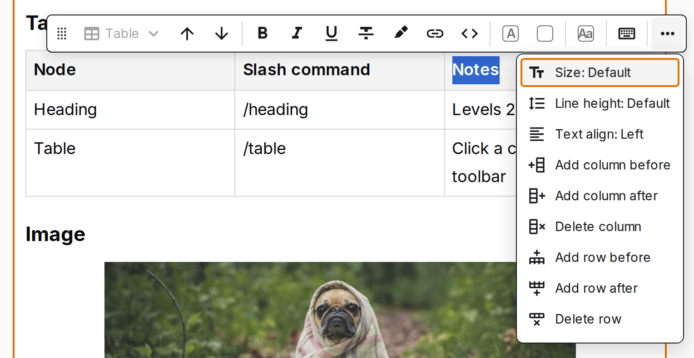

`TablePlugin` adds tables. Insert one from the slash menu ("Table"); a dialog asks for the size
(up to 50 rows and 20 columns) and whether there is a header row.



```php
use Webwizardsusa\RichEditorPlus\Plugins\Table\TablePlugin;
use Webwizardsusa\RichEditorPlus\RichEditorPlus;

RichEditorPlus::make('body')->addPlugins([
    TablePlugin::make()
        ->resizable()              // the default: column widths can be dragged
        ->defaultSize(3, 3, true), // the default: rows, columns and a header row in the insert dialog
]);
```

To offer tables on every field:

```php
RichEditorPlus::registerDefaultPlugins([TablePlugin::class]);
```

## Table tools

While the cursor is in a table, the block toolbar shows the table's tools, even without a selection. Tools that don't
fit go into the More menu.

| Tool | Does |
|---|---|
| `addColumnBefore`, `addColumnAfter`, `deleteColumn` | Columns |
| `addRowBefore`, `addRowAfter`, `deleteRow` | Rows |
| `mergeOrSplit` | Merge the selected cells, or split a merged cell |
| `toggleHeaderRow` | Make the first row a header row, or a normal row |
| `deleteTable` | Delete the whole table |

## Stored content

```html
<table><tbody>
    <tr><th colspan="1" rowspan="1"><p>Name</p></th><th colspan="1" rowspan="1"><p>Role</p></th></tr>
    <tr><td colspan="1" rowspan="1"><p>Ada</p></td><td colspan="1" rowspan="1" colwidth="180"><p>Engineer</p></td></tr>
</tbody></table>
```

- Cells keep `colspan`, `rowspan` and, when a column was resized, its `colwidth` in pixels.
- A cell's alignment is kept as `text-align: left`, `center` or `right`, read from a `style` or an `align` attribute.
- Rendered tables have no wrapper element. Add your own styles, such as borders and `overflow-x: auto` on a parent, on
  the pages that show content.

## Markdown

A field that stores [Markdown](markdown.md) needs `->resizable(false)`, because Markdown has no column widths. Merged
cells, the header row and blocks inside cells also change when written as Markdown; see
[which plugins work](markdown.md#which-plugins-work).

Render content with the same `TablePlugin` settings as the field.
