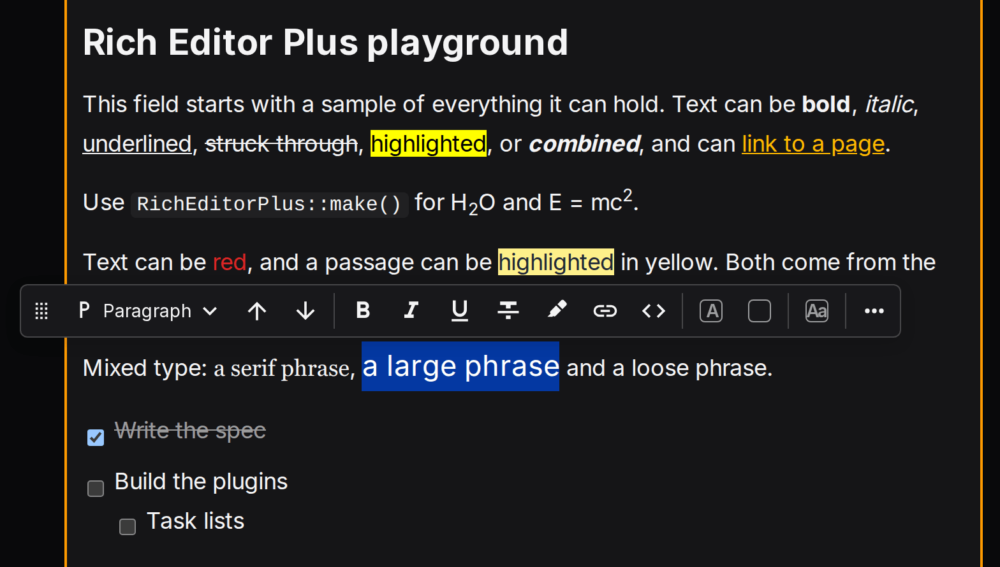
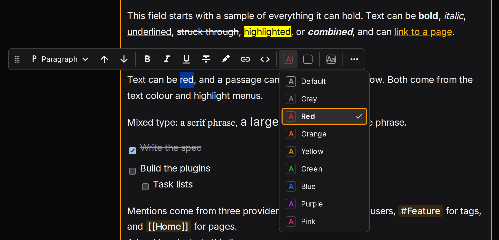
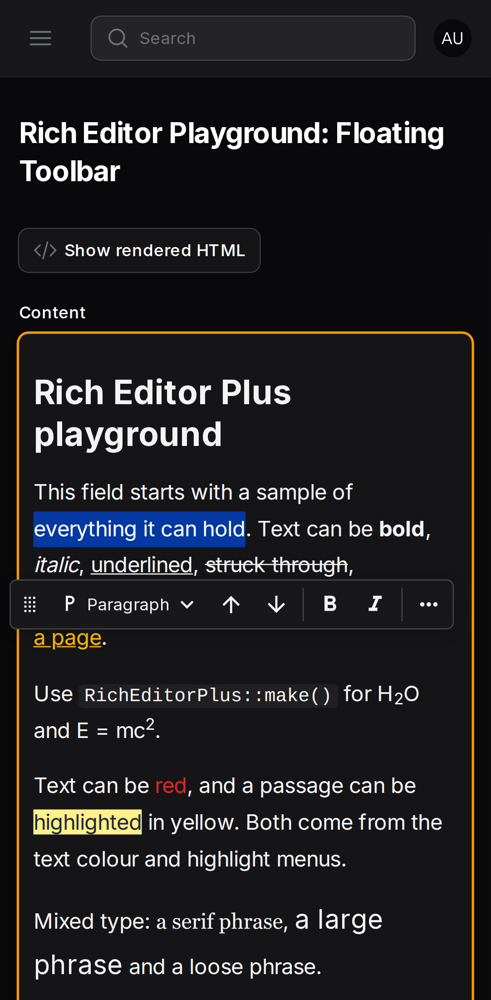

The editor takes its colours from Filament's palette (`--gray-*` and `--primary-*`), so it matches your panel out of
the box. Every colour it uses is a CSS variable on `.rep-editor`, which you can override.

## CSS variables

| Variable | Light default | Dark default | Used for |
|---|---|---|---|
| `--rep-border` | `var(--gray-300)` | `rgb(255 255 255 / 0.1)` | The editor's border |
| `--rep-background` | `#fff` | `rgb(255 255 255 / 0.05)` | The editor's background |
| `--rep-focus` | `var(--primary-600)` | `var(--primary-500)` | Focus rings, the focused border, selected blocks, the drop line, mention backgrounds |
| `--rep-toolbar-background` | `#fff` | `var(--gray-900)` | Toolbars, menus and the find panel |
| `--rep-toolbar-border` | `var(--gray-900)` | `rgb(255 255 255 / 0.2)` | Borders of toolbars, menus and the find panel |
| `--rep-tool-color` | `var(--gray-900)` | `var(--gray-100)` | Toolbar button icons and text |
| `--rep-tool-hover` | `var(--gray-100)` | `rgb(255 255 255 / 0.1)` | Toolbar button hover background |
| `--rep-tool-active-background` | `var(--gray-900)` | `#fff` | Background of an active button (bold text selected, say) |
| `--rep-tool-active-color` | `#fff` | `var(--gray-900)` | Icon of an active button |
| `--rep-divider` | `var(--gray-300)` | `rgb(255 255 255 / 0.2)` | Dividers between toolbar groups and menu sections |
| `--rep-tooltip-background` | `var(--gray-900)` | `var(--gray-100)` | Tooltips |
| `--rep-tooltip-color` | `#fff` | `var(--gray-900)` | Tooltip text |
| `--rep-font` | `inherit` | | The content's and tooltips' font |
| `--rep-text` | `var(--gray-950)` | `var(--gray-100)` | Content text |
| `--rep-muted` | `var(--gray-500)` | `var(--gray-400)` | Placeholders, quotes, menu descriptions, counts |
| `--rep-code-background` | `var(--gray-100)` | `rgb(255 255 255 / 0.05)` | Code blocks and inline code |
| `--rep-find-match` | `rgb(250 204 21 / 0.35)` | `rgb(250 204 21 / 0.2)` | Find and replace matches |
| `--rep-find-current` | `rgb(250 204 21 / 0.75)` | `rgb(250 204 21 / 0.45)` | The current find match |
| `--rep-fixed-toolbar-offset` | `0` | | How far below the top of the screen a sticky fixed toolbar sticks. `var(--topbar-height, 4rem)` in a panel with a topbar, `0px` in a modal. |

## Overriding them

Add your overrides to your panel's [custom theme](https://filamentphp.com/docs/styling/overview) stylesheet. Set light
values on `.rep-editor` and dark values on `.dark .rep-editor`:

```css
.rep-editor {
    --rep-font: 'Inter', sans-serif;
    --rep-toolbar-border: var(--gray-300);
    --rep-tool-active-background: var(--primary-600);
}

.dark .rep-editor {
    --rep-tool-active-background: var(--primary-500);
}
```

Your rules must come after the editor's stylesheet, or be more specific. Filament prints plugin stylesheets before a
panel's theme, so overrides in the theme win. If yours load elsewhere and don't win, repeat the class
(`.rep-editor.rep-editor`) to raise their specificity.

To theme the editor in one place only, scope the variables to an ancestor, such as Filament's modal:

```css
.fi-modal .rep-editor {
    --rep-background: var(--gray-50);
}
```

## Dark mode

The editor follows the panel's theme. When Filament switches to dark mode (the `dark` class on the page), the editor,
its toolbars and its menus switch with it, with no setup.



<p>
  
  &nbsp;
  
</p>

Colours stored in content are not changed in dark mode. The default highlight palette uses dark text so highlighted
text stays readable on a dark background; see [colours and fonts](plugins/colours-and-fonts.md#colours).

## Content styles

The editor styles its content (headings, lists, quotes, code, tables, images) inside `.rep-editor .tiptap`. Those
styles don't reach your own pages; see [in panels and on your pages](displaying-content/on-your-pages.md) for styling
rendered content.
