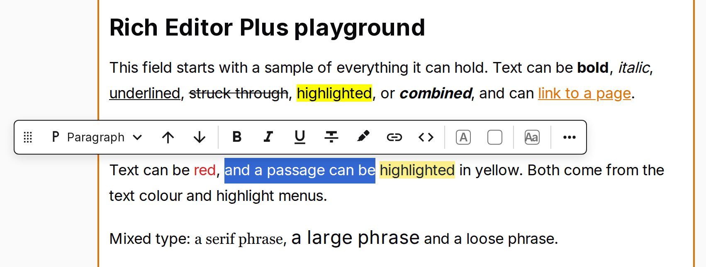
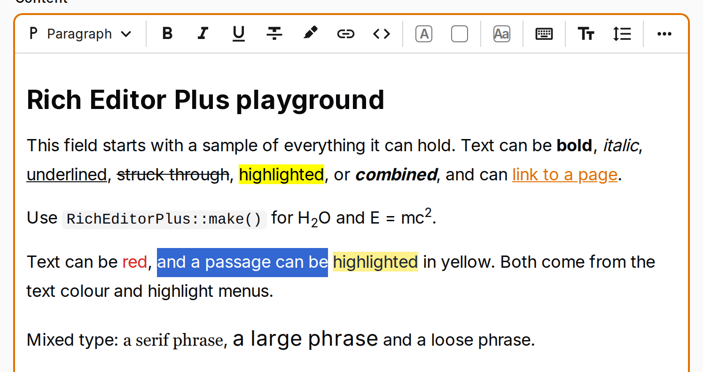
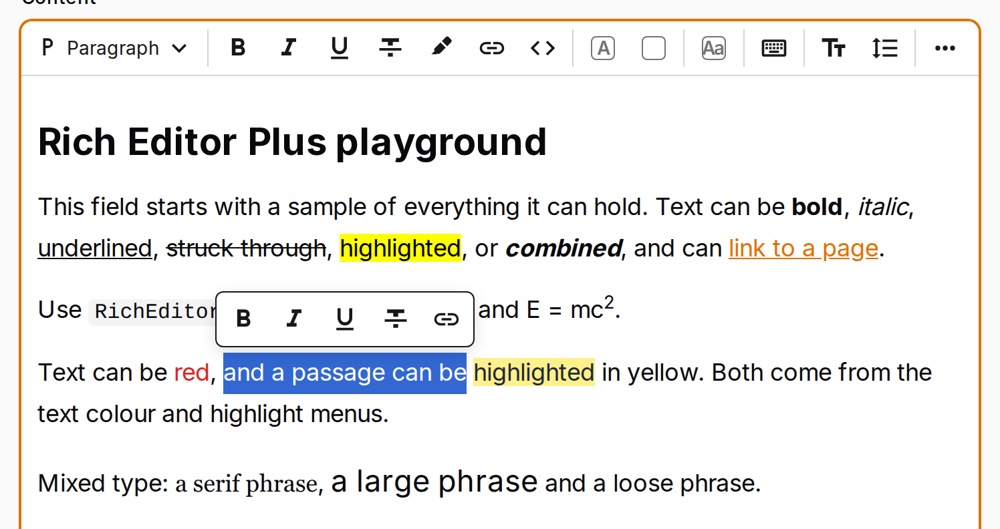
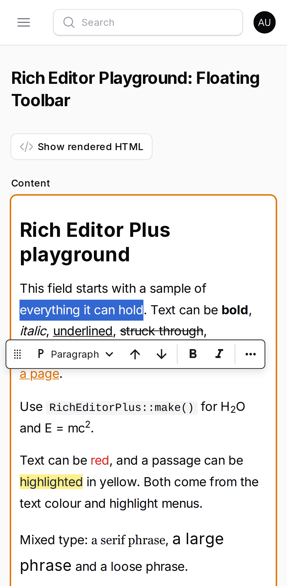
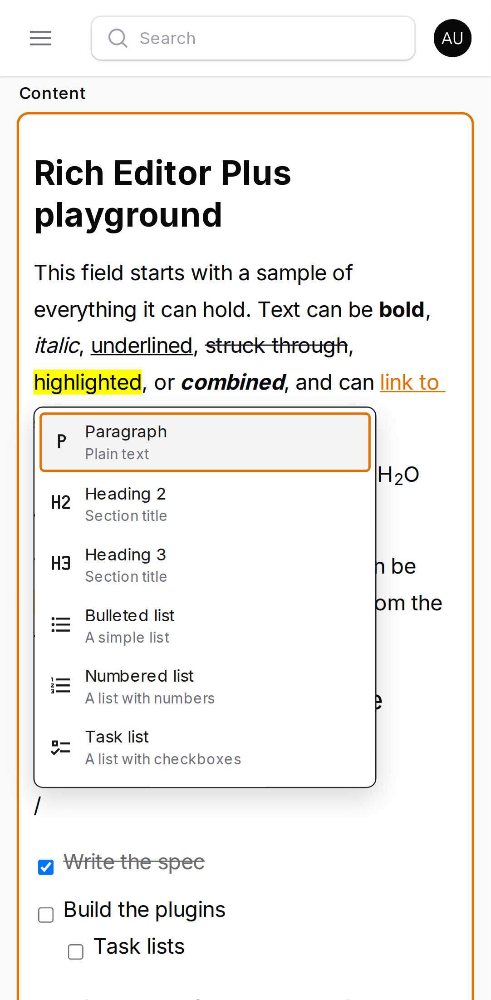

## Floating, fixed or both

A field has a **floating toolbar** by default. It appears above the selection in the active block, or below it on
touch screens, so it stays clear of the browser's own selection menu. A **fixed toolbar** sits above the editor. A
field can have either, both, or neither:

```php
RichEditorPlus::make('body');                                          // floating (the default)
RichEditorPlus::make('body')->fixedToolbar();                          // both
RichEditorPlus::make('body')->fixedToolbar()->floatingToolbar(false);  // fixed only
RichEditorPlus::make('body')->floatingToolbar(false);                  // neither: slash menu and shortcuts only
```

| Floating (the default) | Fixed | Both |
|---|---|---|
|  |  |  |

The fixed toolbar stays in place. Tools that can't be used at the cursor are disabled rather than hidden, and its
block tools section shows the active block's own tools, such as the table tools while the cursor is in a table. A
disabled field still shows its fixed toolbar, with every button disabled, so the field keeps its shape.

### Sticky fixed toolbar

The fixed toolbar sticks to the top of the screen while the editor scrolls past, below a Filament panel's topbar. In a
modal or slide-over it sticks to the top of the modal's own scrolling area instead. Turn it off with:

```php
RichEditorPlus::make('body')->fixedToolbar()->stickyFixedToolbar(false);
```

To move it, for example below a sticky header of your own, set the `--rep-fixed-toolbar-offset` CSS variable on the
editor. It defaults to the panel's `--topbar-height` (or `4rem`) in a panel with a topbar, and `0px` in a modal. The
package sets it with `.fi-body-has-topbar .rep-editor`, so use a selector at least that specific:

```css
body.fi-body-has-topbar .rep-editor {
    --rep-fixed-toolbar-offset: 7rem;
}
```

See [theming](../theming.md) for where to put CSS like this.

## Arranging a toolbar

Choose what a toolbar shows, and in what order, by name. `toolbarTools()` arranges the floating toolbar and
`fixedToolbarTools()` the fixed one. Each inner array is a group, with a divider between groups; a flat list is one
group.

A list of **tool names only** arranges the formatting tools, and the controls (block switcher, More menu and so on)
stay where they are:

```php
RichEditorPlus::make('body')->toolbarTools([
    ['bold', 'italic', 'underline'],
    ['link'],
]);
```

Name a **control**, or the `blockTools` slot, and the list becomes the whole toolbar: only what it names is shown.

| Name | What it is |
|---|---|
| `dragHandle` | Drag to move the block (floating toolbar only) |
| `blockSwitcher` | Change the block type |
| `moveUp`, `moveDown` | Move the block |
| `listOptions` | List type and level, inside a list |
| `blockTools` | The active block's own tools |
| `more` | The More menu |

For example, structure in the fixed toolbar and a small formatting-only floating toolbar:

```php
RichEditorPlus::make('body')
    ->fixedToolbar()
    ->fixedToolbarTools([['blockSwitcher'], ['listOptions', 'blockTools'], ['more']])
    ->toolbarTools([['bold', 'italic', 'link']], onlyListed: true);
```

The rules:

- A list becomes the whole toolbar when it names a control or `blockTools`, or when you pass `onlyListed: true` (to
  either method). `onlyListed: true` is what makes a formatting-only toolbar possible.
- Without either, a list of tool names only rearranges the formatting tools, and the toolbar keeps its controls.
- `fixedToolbarTools()` with no list uses the floating arrangement, `onlyListed` flag included. To keep the fixed
  toolbar's own default layout next to an arranged floating toolbar, call `->fixedToolbarTools(inherit: false)`.
- The drag handle never shows in the fixed toolbar.
- Each name is placed once, and names the field doesn't have are skipped. A toolbar whose list shows nothing is not
  rendered.
- Every argument also takes a closure.

Tools you leave out are hidden, but their keyboard shortcuts still work. To drop a feature completely, remove its
plugin with [`withoutPlugins()`](plugin-sets.md#removing-plugins).

### Tool names

Only **inline** tools (those that act on the selected text) can be arranged by name. Block tools appear in the
`blockTools` slot, and More menu tools in `more`.

| Tool | Plugin |
|---|---|
| `bold`, `italic`, `underline`, `strikethrough` | the mark plugins |
| `code` | `CodePlugin` |
| `link` | `LinkPlugin` |
| `textColor`, `backgroundColor` | `TextColorPlugin`, `BackgroundColorPlugin` |
| `fontFamily`, `fontSize`, `lineHeight` | `FontFamilyPlugin`, `FontSizePlugin`, `LineHeightPlugin` |

The More menu always has "Select parent", "Duplicate" and "Delete" for the current block, with the plugins' More
menu tools between them.

Block tools include `textAlign`, the table tools, `editImage`, `imageAlign`, `imageWidth`, `editAttachment`, and the
level tools of lists and quotes. More menu tools include `findReplace`, `htmlSource`, `markdownSource`, `subscript` and
`superscript`.

## Keyboard access

Hovering over a button, or focusing it from the keyboard, shows its name and shortcut. `Mod` in a shortcut is ⌘ on a
Mac and Ctrl elsewhere.

| Keys | Does |
|---|---|
| Alt+F10 | Move focus into the floating toolbar, or into the fixed toolbar when there is no floating one |
| Arrow keys, Home, End | Move between buttons in a toolbar or menu |
| Escape | Leave the toolbar or menu and return to the editor |
| Alt+Shift+Up / Alt+Shift+Down | Move the current block up or down |
| `/` on an empty line | Open the slash menu |
| Mod+B, Mod+I, Mod+U, Mod+Shift+S | Bold, italic, underline, strikethrough |

Plugins add their own shortcuts, listed on each [plugin's page](../plugins/_index.md).

## On mobile

The editor works with touch screens without any setup:

- The floating toolbar sits below the selection instead of above it.
- It stays inside the visible part of the page, above the on-screen keyboard.
- Tools that don't fit the screen move into the More menu.
- The slash and mention menus fit a phone-width screen.

<p>
  
  &nbsp;
  
</p>
